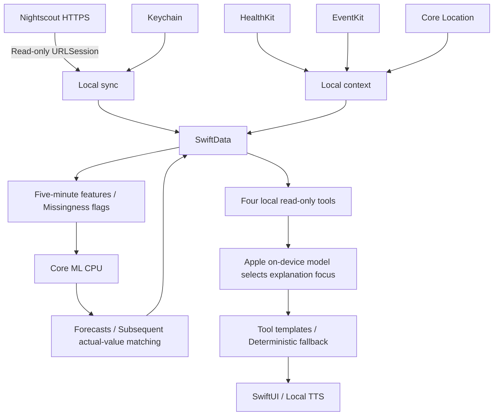

# Implementation status

Implementation began in a standalone repository containing only a README and implementation plan. The original browser repository was not modified, and no private configuration, health CSV files, or credentials were read. The original implementation plan remains unchanged.

| Module | Implemented source functionality |
|---|---|
| Native app | SwiftUI Overview, Lifestyle, Joe, and Settings tabs; Xcode project and shared scheme; minimum iOS 26 |
| Nightscout | HTTPS GET entries/treatments/profile, token or SHA-1 authentication, initial 48-hour window, six-hour overlap, ID upserts, bounded retries, no redirects; full pages are rejected rather than silently truncated |
| Keychain / SwiftData | URL and credentials in ThisDeviceOnly Keychain; local health records, context, features, profiles, forecasts, and errors; no CloudKit; export and clearing |
| HealthKit | Explicit read authorization for steps, heart rate, workouts, and sleep; step statistics, merged sleep intervals, observers; unavailable data stays missing |
| Calendar | Explicit full-access request; current/next event categories; no stored titles, notes, or attendees |
| Location | Coarse location, optional Always Visits/significant changes/geofences, named places, and categorical visit records; no continuous routes |
| Features | UTC five-minute buckets, causal CGM grid, separate missingness flags, and Python/Swift fixtures |
| Forecast | Core ML CPU inference at 30/60 minutes; manifest/input/output validation; stops when model, history, or fresh CGM is unavailable |
| Evaluation | Forecast logs, subsequent ±150-second CGM matching, errors, MAE display, and export |
| Assistant / TTS | Foundation Models availability handling, four read-only tools, structured explanation focus, deterministic template fallback, text input, and installed English speech voices |
| Training | Coverage report, chronological 70/15/15 split with boundary purging, A–D Ridge experiments, persistence, Random Forest comparison, Core ML export, and numerical fixtures |
| Background | Foreground, manual, BGAppRefresh, and HealthKit observer updates; cold-start initialization; no fixed refresh guarantee |

## Verified

- `swift build` successfully builds JoeCore.
- `python3 scripts/check_core.py`: 14 checks pass, including four Python/Swift numerical fixtures.
- Python 3.11: all six `python -m unittest -v test_pipeline.py` checks pass.
- Training → Core ML conversion → local CPU prediction parity passes using temporary synthetic data. Test models are deleted afterward and are not bundled in the app.
- iOS Swift files pass parser checks. NightscoutClient, KeychainStore, and ForecastService pass independent type checking with the local SDK.
- The project, Info.plist, and entitlements pass `plutil -lint`.

**Full iOS compilation and device UI validation remain pending.** At initial verification, only Command Line Tools were installed: `xcodebuild` required full Xcode, and XCTest plus FoundationModels/SwiftData macro plugins were unavailable. `swift test` could not run, so the same test source was compiled directly instead. This is not reported as a successful XCTest run.

## Remaining work

1. Install full Xcode and complete iPhone signing, build/run, system permission, UI, macro expansion, and background lifecycle acceptance testing.
2. Verify public Nightscout HTTPS and real authentication over cellular with Tailscale and the Mac disabled. No private Nightscout instance has been contacted.
3. Train a personalized model using actual historical data. The repository contains no personalized model, real performance metrics, or ablation conclusions.
4. Verify device numerical parity, latency, thermal behavior, battery use, and 3–7 days of shadow mode.
5. Hypoglycemia probability modeling and calibration are not implemented; `lowRisk` is explicitly nil. The offline endpoint threshold screen is not an hour-long risk probability.
6. IOB/COB and active profile schedules/DIA remain unvalidated. Profiles are fetched and persisted only. Basal-rate features use valid Temp Basal absolute events; IOB/COB remain missing.
7. Clarke/Parkes error grids, event warning lead time, and sleep-stratified evaluation remain pending. Basic errors, endpoint screens, and meal/recent-exercise/UTC-overnight strata are implemented. There are no automatic alerts.
8. Source-time retrospective replay cannot reconstruct all arrival delays and does not establish real-time information availability.

## Architecture

See [README](../README.md), [DEVICE_TESTS](DEVICE_TESTS.md), and [FEATURE_SCHEMA](FEATURE_SCHEMA.md).
