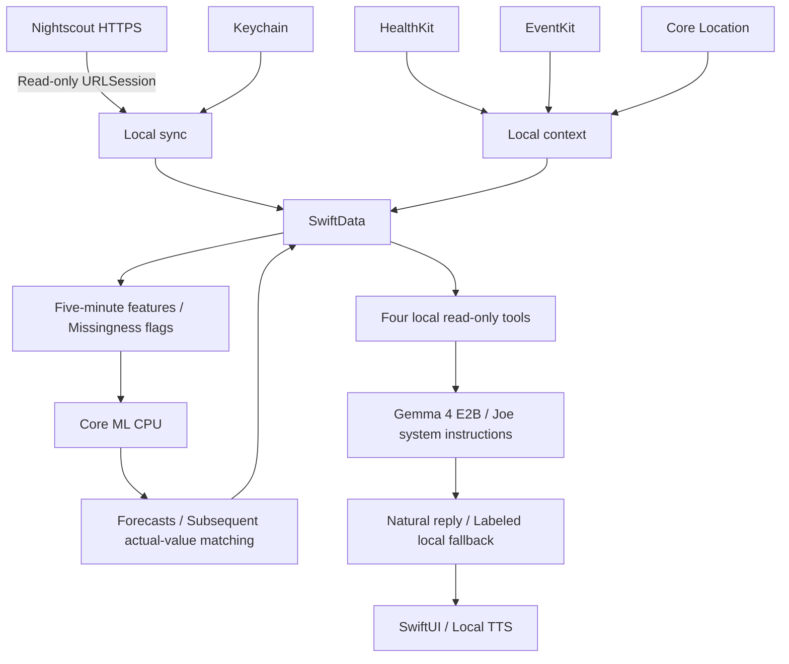

# Implementation status

Implementation began in a standalone repository containing only a README and implementation plan. The original browser repository was not modified, and no private configuration, health CSV files, or credentials were read. The original implementation plan remains unchanged.

| Module | Implemented source functionality |
|---|---|
| Native app | SwiftUI Joe (default chat), Overview, Lifestyle, and Settings tabs; Xcode project and shared scheme; minimum iOS 26 |
| Nightscout | HTTPS GET entries/treatments/profile, token or SHA-1 authentication, initial 72-hour window, six-hour overlap, ID upserts, bounded retries, no redirects; full pages are rejected rather than silently truncated |
| Keychain / SwiftData | URL and credentials in ThisDeviceOnly Keychain; local health records, context, features, profiles, forecasts, and errors; no CloudKit; export and clearing |
| HealthKit | Settings-based explicit read authorization for steps, heart rate, workouts, and sleep; step statistics, merged sleep intervals, observers; unavailable data stays missing |
| Calendar | Settings-based explicit full-access request; current/next event categories plus explicit local day-event title/time lists; requested titles persist in chat/export only; no notes or attendees |
| Location | Coarse location, optional Always Visits/significant changes/geofences, named places, and categorical visit records; no continuous routes |
| Features | UTC five-minute buckets, causal CGM grid, separate missingness flags, and Python/Swift fixtures |
| Forecast | Core ML CPU inference at 30/60 minutes; manifest/input/output validation; stops when model, history, or fresh CGM is unavailable |
| Evaluation | Forecast logs, subsequent ±150-second CGM matching, errors, MAE display, and export |
| Assistant / TTS | Gemma 4 E2B installation and LiteRT-LM availability handling, four read-only tools, Joe persona in session instructions, bounded multi-turn natural conversation, deterministic fallback, text input, English/Mandarin speech voices, and hold-to-talk native Gemma audio input with editable drafts (Apple Speech ASR removed) |
| Training | Coverage report, chronological 70/15/15 split with boundary purging, A–D Ridge experiments, persistence, Random Forest comparison, Core ML export, and numerical fixtures |
| Background | Foreground, manual, BGAppRefresh, and HealthKit observer updates; cold-start initialization; no fixed refresh guarantee |

## Verified

- `swift build` successfully builds JoeCore.
- `python3 scripts/check_core.py`: 20 checks pass, including four Python/Swift numerical fixtures.
- Python 3.11: all six `python -m unittest -v test_pipeline.py` checks pass.
- Training → Core ML conversion → local CPU prediction parity passes using temporary synthetic data. Test models are deleted afterward and are not bundled in the app.
- The app launches in an iOS 27.2 simulator with Joe selected by default; the initial chat, composer, and tab order were visually checked. Voice capture and actual device layout remain pending.
- iOS Swift files pass parser checks. NightscoutClient, KeychainStore, and ForecastService pass independent type checking with the local SDK.
- The project, Info.plist, and entitlements pass `plutil -lint`.

**The full iOS app builds successfully with Xcode 27.2 for generic iOS device and simulator targets with code signing disabled.** This build includes SwiftData macro expansion and LiteRT-LM native linking. The `LocalStore` FileManager argument label was corrected from `atPath:` to `ofItemAtPath:`. Signed installation and device UI validation remain pending.

Initial verification used Command Line Tools without XCTest or the required macro plugins. The earlier core checks compiled the test source directly and were not reported as an XCTest run. With full Xcode available, all 48 XCTest tests now pass.

## Chat and navigation update

Joe is the default tab and displays a session conversation with a bottom text/voice composer. Hold-to-talk transcribes locally to an editable draft; sending remains explicit. HealthKit, calendar, and location setup live in Settings. Lifestyle displays only current data. Overview uses Nightscout trend arrows and selectable 3/6/12/24-hour dot charts; its pump card shows only the latest bolus, excluding basal and future events. New core tests cover trend mappings and bolus selection. Microphone permissions, recording/release, audio interruptions, and real-device layouts require device acceptance testing.

## Icon, local conversation, and audio update

- The supplied T1D Ally PNG is resized to an opaque 1024×1024 AppIcon asset; both build configurations select it.
- Gemma 4 E2B replaces Apple Intelligence entirely. LiteRT-LM 0.19.1 is pinned in Xcode; a verified 2.59 GB model is downloaded over Wi-Fi or imported explicitly. Settings provides progress, cancellation, load/unload and removal. Joe persona/safety/explanation remain system instructions. Selected local tool results and bounded memory are user-message data; Swift gating and validation remain in force.
- Cloud settings and the cloud network client were removed following the user's clarification. Only a delete-only Keychain migration remains to remove a previously saved prototype credential.
- Voice input uses stable UIKit touch tracking, token-guarded authorization/callbacks, and a five-second finalization window. Settings provide English/Mandarin selection and automatic reading.
- Read-aloud now writes local synthesized PCM into a temporary audio file, rejects empty/silent synthesis, and plays through `AVAudioPlayer`. Settings expose a tone test, voice test, playback state, output route, and media volume. Temporary speech is removed when stopped or finished.
- Core tests cover persona placement, bounded conversation prompts, and canceled/released input. `scripts/check_speech_renderer.py` checks PCM persistence, silent/empty rejection, and cancellation without playing sound. Natural model responses and audible output still require device acceptance testing.

## Safety/prompt architecture plan

The new [architecture implementation](PROMPT_ARCHITECTURE_IMPLEMENTATION.md) maps the sibling prompt/model plan to code. Safety decisions, deterministic gating, structured tools, actual tool-call evidence, response screening, split/versioned prompts, distinct availability/errors, short session memory/on-demand automatic Gemma loading, persistent versioned dialogue logs, and ten bilingual persona fixtures are implemented. All 86 XCTest checks pass; a ten-case Mac Gemma run produced nine screened replies and one rejection fallback; iPhone generation and manual persona review remain pending. The committed regression report is explicitly a deterministic/fake-provider run.

## Remaining work

1. Complete signed iPhone installation and device testing of system permissions, UI, and background lifecycle behavior.
2. Verify public Nightscout HTTPS and real authentication over cellular with Tailscale and the Mac disabled. No private Nightscout instance has been contacted.
3. Train a personalized model using actual historical data. The repository contains no personalized model, real performance metrics, or ablation conclusions.
4. Verify device numerical parity, latency, thermal behavior, battery use, and 3–7 days of shadow mode.
5. Hypoglycemia probability modeling and calibration are not implemented; `lowRisk` is explicitly nil. The offline endpoint threshold screen is not an hour-long risk probability.
6. IOB/COB and active profile schedules/DIA remain unvalidated. Profiles are fetched and persisted only. Basal-rate features use valid Temp Basal absolute events; IOB/COB remain missing.
7. Clarke/Parkes error grids, event warning lead time, and sleep-stratified evaluation remain pending. Basic errors, endpoint screens, and meal/recent-exercise/UTC-overnight strata are implemented. There are no automatic alerts.
8. Source-time retrospective replay cannot reconstruct all arrival delays and does not establish real-time information availability.

## Architecture

See [README](../README.md), [DEVICE_TESTS](DEVICE_TESTS.md), and [FEATURE_SCHEMA](FEATURE_SCHEMA.md).

## Gemma migration

See [Gemma setup](GEMMA_SETUP.md). The dependency and model revision/hash are pinned; 48 core tests pass including integrity rejection and tool-payload routing. Device and simulator build verification is recorded in the setup document. On-device speed, peak memory, thermal behavior, voice audibility and model persona quality still require iPhone 15 Pro acceptance testing. This change ports prompting and orchestration; it does not fine-tune weights or add LoRA.

## Automatic Gemma lifecycle

Eligible chat requests and synthetic regression wait for installed-file verification and a shared automatic load; launch alone does not initialize weights. Active-use leases protect generation from idle release. Foreground idle is 5 minutes; background idle is 2 minutes, with foreground elapsed-time recheck because iOS may suspend timers. Background entry cancels active generation/initialization but retains an already-ready idle engine for brief switches. Memory warnings release it. The next eligible request reloads automatically; failed loads do not loop. Manual load/unload remain available. Native Mac load/generate/idle-release/reload verification passes; actual iPhone suspension/memory-pressure behavior remains an acceptance check.

## Time evidence and 72-hour history

Facts are validated against the provider's executed immutable snapshot; post-generation safety/freshness has a separate gate and log reasons. Absolute event timestamps include the device timezone and UTC offset. Minute-boundary, wrong-dose, wrong-time, DST and old-log-decoding regressions pass. Explicit three-day queries refresh Nightscout entries over the last 72 hours, combine visible Health history without duplicate-bin inflation, and expose coverage plus observed local-day summaries. No real credentials or health records were accessed during implementation checks.

## Native Gemma audio input (November 16)

Apple Speech input is replaced with microphone-only PCM WAV recording and Gemma's native audio encoder via LiteRT-LM 0.19.1. English/Mandarin language hints and a conditional domain vocabulary prompt produce an editable question before the existing grounded-answer pipeline. Text input and system TTS remain. Capture is bounded to 20 seconds; temporary audio is removed after processing/cancellation and stale capture files on startup. Model load/unload protection covers the audio pass, and concurrent native generations are rejected.

All 90 core tests pass. Unsigned iOS build and an actual pinned-model Mac CPU audio→draft→text-chat smoke pass; see [synthetic audio report](reports/gemma-native-audio-smoke.v1.json). Initial synthetic bolus/bonus confusion informed a domain-vocabulary prompt fix; real iPhone audio accuracy and performance remain unverified. See [customization file map](MODEL_CUSTOMIZATION.md) and [device tests](DEVICE_TESTS.md).

## Apple Health activity chat queries

Added independently refreshed, structured HealthKit activity evidence for today's local cumulative step count and the latest recorded HR sample within a day. This does not change causal 30-minute forecast features. English `hr`/`bpm`/`pulse`, step-count phrasing and Chinese noun-phrase questions select the context tool. Empty reads, query failure, collection off and unavailable devices have distinct statuses; iOS read authorization is not inferred. Model replies must include requested available values and the actual HR measurement time; old samples cannot be described as live. Other requested activity time windows are explicitly unsupported. Query evidence expires after 15 minutes or at local midnight; urgent CGM safety still takes priority.

All 96 core tests and the unsigned iPhone build pass. Real Gemma Mac CPU generation is checked with synthetic step/HR values, not private HealthKit records. Actual phone permission grants, Watch synchronization, source merging and locked-device behavior remain device acceptance checks.

## Conversational iCloud calendar replies

Ordinary calendar questions now ask Gemma for factual highlights, a brief tentative interpretation of recorded commitments and an optional natural invitation. Explicit all/full-list requests retain complete records. Named event dates/start times, requested bounds, language and tool evidence are still checked; overview mode no longer requires every event/end time. Swift supplies weekday labels and rejects weekday/weekend claims unsupported by recorded event dates. Interpretations do not establish mood, free time, full cloud synchronization or health effects. Model/validation failures retain the factual fallback.

Both explicit range queries and current/next context use only identifiable iCloud sources, excluding other accounts and subscribed/birthday calendars. Missing iCloud sources get a distinct message and never become calendars:nil. Public EventKit source type/name metadata is used conservatively; renamed/unknown sources fail closed. Settings shows source status. Historical saved chat is retained.

All 104 core tests and the unsigned iPhone build pass. The native Mac CPU smoke covers weekly interpretation, English/Chinese daily overviews, a six-event overview and an explicit complete list. See [calendar interpretation report](reports/calendar-interpretation-icloud-model-smoke.v1.json) for observed outcomes and limitations. Actual iPhone iCloud labeling, source exclusion, synchronization and voice acceptance remain manual checks.

## Automatic voice-message delivery

Releasing a valid recording now immediately inserts one outgoing user bubble with spinner/ellipsis. Native Gemma recognition replaces that same UUID's contents with spoken words and automatically starts the normal fact-query/answer pipeline, with no draft review or second Send tap. Text drafts remain independent. Failure/cancellation stops the spinner, shows a clear bubble status, and cannot submit a partial/late question. Nonrecognized placeholders stay out of replay and completed-turn persistence. Audio inference ends before the answer task starts; temporary WAV cleanup remains local. Recognition instructions and the audio model itself are unchanged, so this is a delivery/UI change, not an accuracy benchmark.

All 109 core tests and the unsigned iPhone build pass. New state-machine regressions cover stable identity, exactly-once completion, cancellation, late failure/success, empty input, and identical spoken text in separate recordings. Actual microphone interaction, UI transitions and automatic playback/cancellation need the device checks in DEVICE_TESTS.md.
