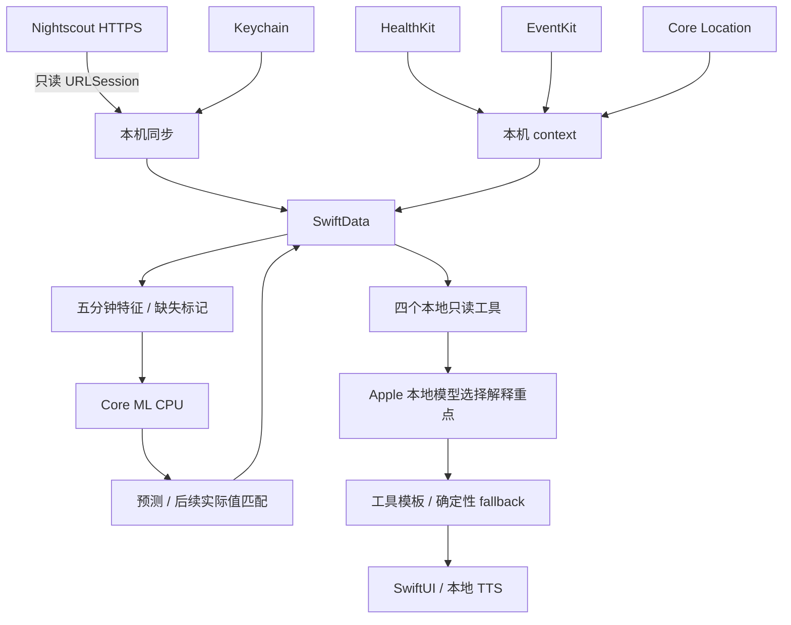

# 实际交付状态

本次从仅含 README 和 implementation plan 的独立 repo 开始实现。旧 browser repo 未修改；未读取私人配置、健康 CSV 或凭据。原 implementation plan 保持原样。

| 模块 | 已实现源码 |
|---|---|
| Native app | SwiftUI 概览、生活、Joe、设置；Xcode 工程与共享 scheme；最低 iOS 26 |
| Nightscout | HTTPS GET entries/treatments/profile，token 或 SHA-1；48h 首次窗口、6h overlap、id upsert、有限重试、禁止重定向；满页响应拒绝静默截断 |
| Keychain / SwiftData | 地址凭据仅存 ThisDeviceOnly Keychain；健康记录、context、特征、profile、预测及误差存本机；无 CloudKit；支持导出与清除 |
| HealthKit | 主动授权读取步数/心率/运动/睡眠，统计步数、合并睡眠；observer；无数据为缺失 |
| Calendar | 主动申请 full access，当前/下一项类别；不保存标题、备注或参与者 |
| Location | 粗定位、可选 Always Visits/significant changes/geofences、主动命名地点、类别访问记录；无连续轨迹 |
| Features | UTC 五分钟桶、因果 CGM 网格、独立 missing flag；Python/Swift fixture |
| Forecast | Core ML CPU 推理 30/60 分钟；manifest/输入/输出校验；模型缺失、历史不足和 CGM 过期时停止预测 |
| Evaluation | 预测日志、后续 ±150s CGM 匹配、误差、MAE 展示与导出 |
| Assistant / TTS | Foundation Models availability、四个只读工具、结构化解释重点、确定性模板 fallback、文字输入、已安装系统语音朗读 |
| Training | 数据覆盖报告、70/15/15 时间切分与 boundary purge、A–D Ridge、persistence、Random Forest 对照、Core ML 导出与数值 fixture |
| Background | 前台、手动、BGAppRefresh、HealthKit observer；支持冷启动初始化；不承诺固定刷新周期 |

## 已验证

- `swift build` 构建 JoeCore 成功。
- `python3 scripts/check_core.py`：14 项检查通过，含四组 Python/Swift 数值 fixture。
- Python 3.11：`python -m unittest -v test_pipeline.py` 六项检查通过。
- 训练 → Core ML 转换 → 本机 CPU 预测 numerical parity 通过；只在临时合成数据上验证，模型随后删除，未打包进 app。
- iOS Swift 文件 parser 检查通过；NightscoutClient、KeychainStore、ForecastService 在本机 SDK 下通过独立 typecheck。
- 工程、Info.plist、entitlements 通过 `plutil -lint`。

**没有完成完整 iOS 编译或真机 UI 验证。** 当前仅有 Command Line Tools，`xcodebuild` 要求完整 Xcode；也缺少 XCTest 与 FoundationModels/SwiftData 宏插件。`swift test` 无法运行，使用直接编译的同源检查，不将其描述为 XCTest 通过。

## 仍需完成

1. 安装完整 Xcode，完成 iPhone 签名、build/run、系统权限、UI、宏代码与后台生命周期验收。
2. 蜂窝网络下验证 Nightscout 的公开 HTTPS 和真实认证；关闭 Tailscale 与 Mac。未调用用户私人 Nightscout。
3. 使用个人历史数据训练真实模型。仓库没有个人模型、真实指标或 ablation 结论。
4. 设备 numerical parity、延迟、热量、电池测量，以及 3–7 天 shadow mode。
5. 低血糖概率模型与校准未实现，`lowRisk` 明确为空；离线 endpoint threshold screen 不等同于整小时风险概率。
6. IOB/COB 与 active profile schedule/DIA 尚未验证。profile 只读取并持久化；基础率只使用有效 Temp Basal absolute 事件，IOB/COB 始终缺失。
7. Clarke/Parkes error grid、事件预警提前量与睡眠分层仍需补充。已有普通误差、endpoint screen、餐食/近运动/UTC 夜间分层；无自动预警。
8. source-time 回顾性重放无法还原所有数据到达延迟，不能声称实时信息可用性已经验证。

## 架构

见 [README](../README.md)、[DEVICE_TESTS](DEVICE_TESTS.md) 与 [FEATURE_SCHEMA](FEATURE_SCHEMA.md)。
